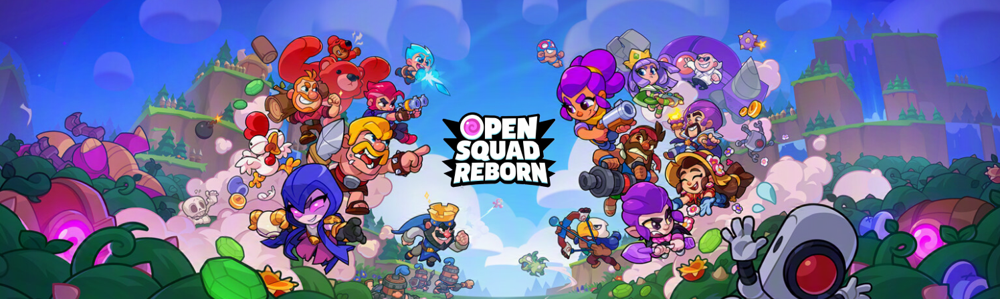
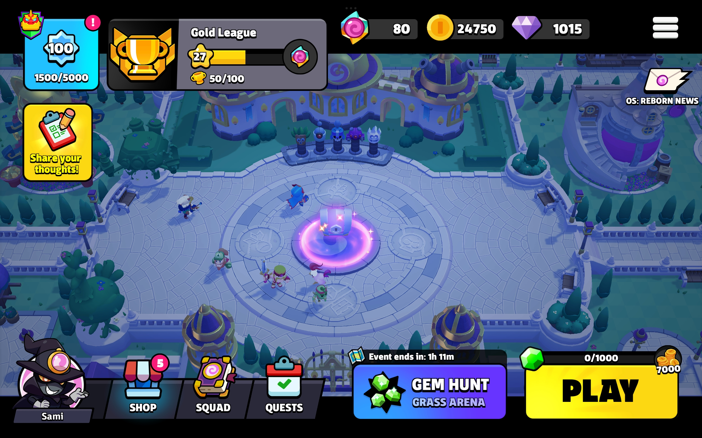

# OpenSquad: Reborn APK
Repository for the official OpenSquad: Reborn APK, a modification of the original [OpenSquad client by 8Hacc](https://github.com/8-bitHacc/OpenSquad).

# Requirements and usage
- Android device with Android 10 or higher

- Pydroid 3 (for running the server)

- Download the latest APK from [this link](https://transfer.it/t/PGNu6W4DUBgQ)

- Use [8Hacc's code](https://github.com/8-bitHacc/OpenSquad) in Pydroid 3 (more instructions down below)

- Enjoy the game!

# How to actually run the server and play the game?
**1.** Download Pydroid 3 from the [Google Play store](https://play.google.com/store/apps/details?id=ru.iiec.pydroid3)

**2.** Download the **ZIP** containing the code from 8Hacc's code by tapping on the green **Code** button and choosing **Download ZIP**

**3.** After extracting the ZIP go to **Pydroid**, allow permissions to access files on your devices, find the folder containing the code (might have the name OpenSquad-master or OpenSquad-main) and do the following things:

- Select the cryptoInstaller.py file and run it!

- Close the file after the process ends, and select Main.py and run it. Voila! The server is running and waiting!

Important note: **DO NOT CLOSE THE APP WHILE THE CODE IS RUNNING**. Instead, make the app run in the background through your app settings! 

**4.** Download the latest APK from [this link](https://transfer.it/t/PGNu6W4DUBgQ)

**5.** Enjoy OpenSquad: Reborn!

# Additions and bug fixes for the future

- Strange behaviour when entering a match/training grounds where the transition is laggy

- Ultimate skins being white

- Some small errors for some animations

- Low resolution loading screens on certain updates

- Rest of the skins from higher versions

- More Squaddies

# Follow me!
- Discord server: [here](https://discord.gg/9VNXJKr3D)

- (Or DM me: @super_sushi1234)

- YouTube Channel: [here](https://www.youtube.com/@SamiStudiosOfficial)

- Telegram channel: [here](https://t.me/SamiStudiosOfficial)

# Special thanks
- 8Hacc and his team for creating OpenSquad

- Sami (me) for making the new clients :)
